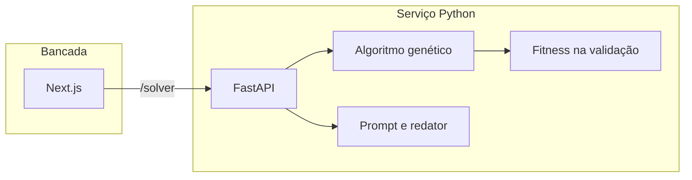

# Arquitetura

A Acuria é a entrega do Projeto 1 da Fase 2: otimizar hiperparâmetros de modelos de diagnóstico com algoritmo genético e traduzir o resultado para a equipe médica.

O navegador fala só com o Next.js, na porta 43123. O Next encaminha `/solver/*` para a API na porta 8741. A API é quem treina, mede e escreve.

## Recorte dos dados

A coorte humana padrão é o `solver/data/data.csv`: 569 exames e 30 medidas de núcleo celular. A classe positiva é maligno: 212 casos, contra 357 benignos. O mesmo diretório guarda a próstata, aceita como outra coorte humana, e as três bases falsas do Módulo 1 (animais e dois arquivos de mama), que a triagem devolve sem treinar.

Os modelos treinados do Módulo 1 não estavam nesses arquivos. As baselines são regressão logística, árvore de decisão, floresta aleatória e K vizinhos, com os hiperparâmetros de fábrica do scikit-learn.

O recorte, fixo na semente 42, é:

| Fatia | Casos | Malignos |
| --- | ---: | ---: |
| Treino | 341 | 127 |
| Validação | 114 | 43 |
| Teste | 114 | 42 |

A busca só vê treino e validação. O teste entra depois, no comparativo.

## Algoritmo

Cada indivíduo é um vetor de genes em \[0, 1\]. A decodificação está em `solver/acuria/encoding.py`. O último gene de todo modelo vira o limiar de malignidade, entre 0,30 e 0,70.

A função fitness, em `solver/acuria/training.py`, é:

`0,50 × recall + 0,35 × F1 + 0,15 × precisão`

da classe maligna na validação. A população inicial inclui o gene do modelo de fábrica, e o elitismo impede que a validação piore.

Operadores, em `solver/acuria/genetic.py`:

- seleção por torneio
- cruzamento por mistura, uniforme ou um ponto
- mutação gaussiana por gene, com chance de repor o gene
- elitismo

As três configurações pedidas pelo desafio estão em `experiment_configs`: exploratória, balanceada e intensiva. Na floresta, população e gerações caem porque cada avaliação treina dezenas de árvores.

## Leitura em linguagem natural

`solver/acuria/language.py` monta o prompt, chama um modelo compatível com a API da OpenAI quando existe `OPENAI_API_KEY` e, sem chave ou se a chamada falha, usa um redator local preso aos mesmos fatos. A checagem de qualidade confere ressalva clínica, classe apontada, probabilidade e nomes reais das características. O gabarito do caso não entra no prompt.

## Escala e registro

A busca trava a CPU de um processo. A API aceita uma otimização por vez e responde 429 se outra chegar no meio. Métricas e eventos ficam em memória e aparecem em `/api/metrics` e `/api/logs`. O modelo ajustado também fica em memória, então mais de um processo exigiria sessão presa ou um depósito compartilhado das buscas. Nuvem e autoscaling ficam de fora: o enunciado trata isso como ponto extra.

## Limites

A distância entre variáveis correlatas, como raio, perímetro e área, divide o peso da logística entre elas. O teste é pequeno, 42 malignos, então um limiar bom na validação pode perder recall no teste. O texto gerado é apoio de ensino, não laudo.
